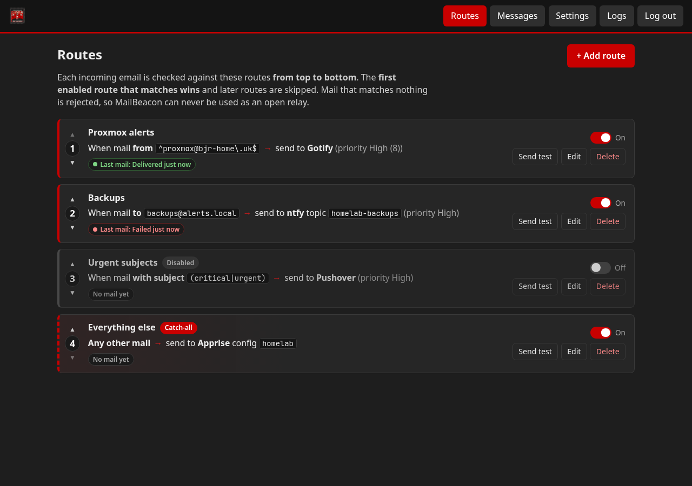
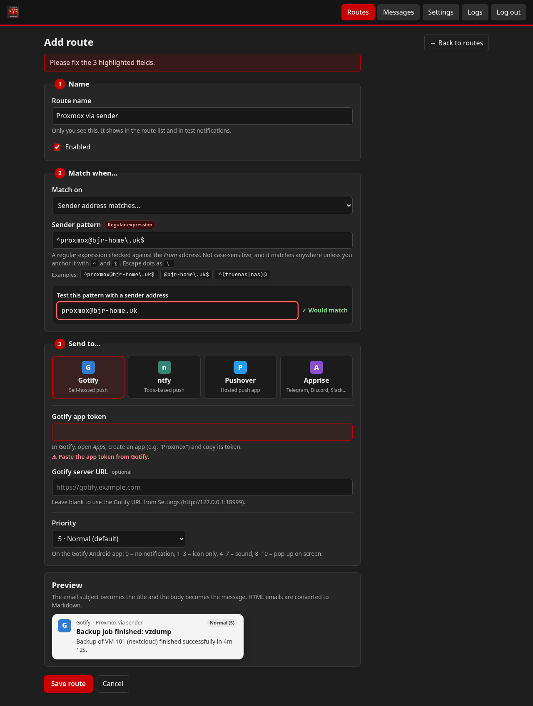
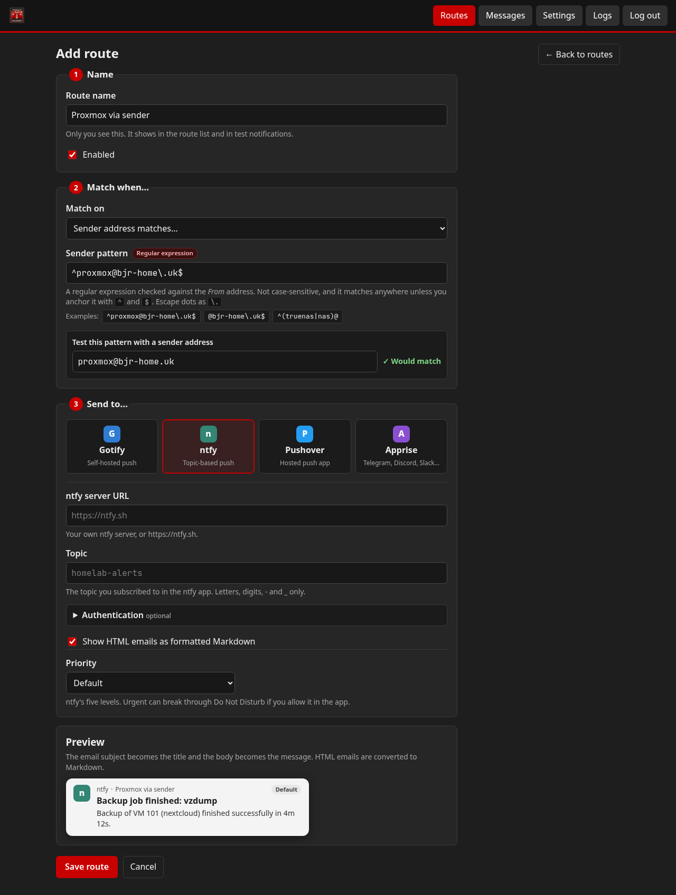

<p align="center">
  <picture>
    <source media="(prefers-color-scheme: dark)" srcset="docs/logo-with-title-dark.svg">
    
  </picture>
</p>

<p align="center">
  <strong>Turn email alerts into push notifications.</strong><br>
  A tiny SMTP server for apps that can only shout by email: it routes every message to Gotify, ntfy, Pushover or Apprise.
</p>

<p align="center">
  <a href="https://github.com/Nerdy-Technician/MailBeacon/actions/workflows/ci.yml"></a>
  <a href="https://github.com/Nerdy-Technician/MailBeacon/releases/latest"></a>
  <a href="https://github.com/Nerdy-Technician/MailBeacon/pkgs/container/mailbeacon"></a>
  <a href="LICENSE"></a>
</p>

<p align="center">
  
</p>

## Contents

- [Features](#features)
- [Quick start](#quick-start)
- [Configuration](#configuration)
- [Routing](#routing)
- [Notification targets](#notification-targets)
- [Single sign-on (Authentik)](#single-sign-on-oidc)
- [STARTTLS and AUTH](#starttls-and-auth)
- [Example app configs](#example-app-configs)
- [Reverse proxy (Traefik)](#reverse-proxy-traefik)
- [Security](#security)
- [Development](#development)
- [Contributing](#contributing)
- [License](#license)

## Features

- **Four targets:** Gotify, ntfy, Pushover, and anything [Apprise](https://github.com/caronc/apprise) can reach (Discord, Telegram, Slack, Matrix, email and 100+ more).
- **Flexible routing:** by recipient (`proxmox@alerts.local` or `*@alerts.local`), sender regex or subject regex, plus an optional catch-all. First match wins.
- **Sensible mapping:** subject becomes the title, body becomes the message, HTML mail is converted to Markdown, and priority is set per route.
- **No open relay:** anything that matches no route is rejected with `550` during the SMTP conversation.
- **STARTTLS and SMTP AUTH**, both optional, with an auto-generated certificate if you don't bring one.
- **Friendly web UI:** routes read like sentences, with a live pattern tester, a notification preview, a **Send test** button, recent messages with retry, and logs.
- **Single sign-on** with any OpenID Connect provider (Authentik, Keycloak, Authelia, Pocket ID...) next to the local admin password.
- **Secrets encrypted at rest** (AES-256-GCM) and passwords hashed with scrypt.
- **Automatic retries** for failed deliveries.
- **One container, one volume:** multi-arch image (`amd64`, `arm64`) with everything in `/data`.

<details>
<summary>More screenshots</summary>

<p align="center">
  <br>
  
</p>
</details>

## Quick start

```yaml
# docker-compose.yml
services:
  mailbeacon:
    image: ghcr.io/nerdy-technician/mailbeacon:latest
    container_name: mailbeacon
    restart: unless-stopped
    environment:
      MAILBEACON_SECRET: change-me-to-a-long-random-string   # openssl rand -hex 32
      TZ: Europe/London
    ports:
      - "2525:2525"   # SMTP
      - "8080:8080"   # Web UI
    volumes:
      - ./data:/data
```

```bash
docker compose up -d
```

1. Open `http://<host>:8080` and set the admin password (8+ characters).
2. Go to **Routes → Add route**. Name it, choose what to match (for example recipient `proxmox@alerts.local`) and where to send it (for example a Gotify app token).
3. Press **Send test** on the route and check your phone.
4. Point your apps at `<host>:2525` as their SMTP server, with no encryption and no login (unless you turn those on).

Try it from any machine with [swaks](https://jetmore.org/john/code/swaks/):

```bash
swaks --server <host>:2525 --from pve@alerts.local --to proxmox@alerts.local \
      --header "Subject: Backup finished" --body "vzdump of VM 101 finished in 4m 12s"
```

Pin a version instead of `latest` if you prefer: `ghcr.io/nerdy-technician/mailbeacon:0.1.0` or `:0.1`.

## Configuration

Almost everything is set in the web UI. Environment variables cover ports, the encryption key and SSO.

| Variable | Default | Description |
|---|---|---|
| `MAILBEACON_SECRET` | *(empty)* | Encryption key source for tokens/credentials. If unset, a random key is written to `/data/secret.key` and a warning is logged. **Changing it makes stored tokens unreadable.** |
| `MAILBEACON_DATA_DIR` | `/data` | Where the DB, key and TLS files live. |
| `MAILBEACON_SMTP_PORT` | `2525` | SMTP listen port. |
| `MAILBEACON_WEB_PORT` | `8080` | Web UI / API port. |
| `MAILBEACON_HOST` | `0.0.0.0` | Bind address for both listeners. |
| `MAILBEACON_MAX_SIZE_KB` | `1024` | Max message size; bigger mail gets `552`. |
| `MAILBEACON_SMTP_HOSTNAME` | `mailbeacon` | SMTP greeting name and self-signed cert CN. |
| `MAILBEACON_GOTIFY_URL` | *(empty)* | Seeds the global Gotify URL on first start only. |
| `MAILBEACON_PUBLIC_URL` | *(empty)* | The URL you open MailBeacon on, e.g. `https://mailbeacon.example.com`. Used to build the OIDC redirect URI. If unset it is guessed from the request. |
| `MAILBEACON_OIDC_ISSUER` | *(empty)* | OIDC issuer URL. Setting this and the client ID turns on the "Log in with single sign-on" button. |
| `MAILBEACON_OIDC_CLIENT_ID` | *(empty)* | OIDC client ID. |
| `MAILBEACON_OIDC_CLIENT_SECRET` | *(empty)* | OIDC client secret. |
| `MAILBEACON_OIDC_SCOPES` | `openid profile email` | Scopes to request. |
| `MAILBEACON_OIDC_ALLOWED` | *(empty)* | Comma-separated emails and/or group names allowed in. Empty lets in anyone the provider authenticates. |
| `MAILBEACON_FORCE_LOCAL_LOGIN` | *(empty)* | Set to `1` to turn password login back on if you locked yourself out of SSO. |

OIDC values set by environment variables override the ones saved in the UI and are shown greyed out there.

### The `/data` volume

Everything MailBeacon keeps lives in `/data`; back up the whole folder.

| Path | What it is |
|---|---|
| `mailbeacon.db` | SQLite database: routes, settings, users, messages, logs |
| `secret.key` | Encryption key, only created if `MAILBEACON_SECRET` is not set |
| `tls/cert.pem`, `tls/key.pem` | STARTTLS certificate and key (generated if missing) |

The container starts as root only long enough to `chown` `/data` to the `node` user, then drops privileges, so a
folder Docker creates as root just works. Run it with `user: "1000:1000"` to skip that step entirely.

> **Keep your key.** If you lose or change `MAILBEACON_SECRET` (or `secret.key`), stored tokens can't be decrypted
> and you'll need to re-enter them.

## Routing

Each route says **when** a message matches and **where** it goes. Routes are checked top to bottom and the
**first enabled route that matches wins**; later routes are ignored for that message.

| Match on | Pattern example | Notes |
|---|---|---|
| Recipient | `proxmox@alerts.local`, `*@alerts.local` | Exact address or `*` glob, case-insensitive. Checked at `RCPT TO`. |
| Sender | `^root@pve\d+\.lan$`, `.*@nas\.lan` | Case-insensitive regex on the envelope sender (`MAIL FROM`). |
| Subject | `(fail\|error\|critical)` | Regex, checked once the message has arrived. |
| Catch-all | — | Matches everything. |

- Put specific routes first and broad ones (like a catch-all) last. New routes are added above an existing catch-all automatically.
- Without a catch-all, MailBeacon only accepts mail it knows what to do with. Leave it out to stay strict.
- If any subject route exists, unknown recipients are accepted at `RCPT TO` and rejected with `550` after `DATA` when the subject doesn't match either.
- The route form has a **test this pattern** box that tells you whether a sample address or subject would match before you save.
- Use ▲/▼ to reorder, the switch to turn a route off without deleting it, and **Send test** to check its target.

Example set:

1. Subject `fail|error|critical` → Gotify, priority 10 (anything failing shouts, whoever sent it)
2. Recipient `proxmox@alerts.local` → Gotify "Proxmox" token, priority 5
3. Sender `@nas\.lan$` → ntfy topic `nas`
4. Catch-all → Gotify "Misc" token, priority 2

## Notification targets

Pick the target per route under **Send to**. Leaving a secret field blank when editing keeps the stored value.

| Target | Settings | Notes |
|---|---|---|
| **Gotify** | App token, priority 0–10, optional server URL | Uses the server URL from **Settings** unless the route overrides it. Markdown is rendered for HTML mail. |
| **ntfy** | Server URL, topic, access token *or* username/password, priority 1–5, Markdown on/off | Works with ntfy.sh and self-hosted servers. |
| **Pushover** | App token, user or group key, priority −2 to 1, HTML on/off | Title up to 250 and message up to 1024 characters. Emergency priority isn't offered. |
| **Apprise** | Apprise API URL, plus notification URLs *or* a saved config key | Run the [apprise-api](https://github.com/caronc/apprise-api) container. The URLs are stored encrypted because they usually contain credentials. |

**Send test** and **Retry** work for every target. Failed deliveries are retried every minute, up to 5 attempts.

## Single sign-on (OIDC)

MailBeacon uses standard OpenID Connect (authorisation code flow with PKCE, state and nonce). Configure it in
**Settings → Single sign-on** or with the `MAILBEACON_OIDC_*` variables; environment values win and show greyed out
in the UI. The redirect URI to register with your provider is `<public URL>/api/oidc/callback`, and it's shown on the
Settings page.

The local admin password keeps working alongside SSO. After one successful SSO login you can tick **Disable password
login**. If SSO breaks later, start the container with `MAILBEACON_FORCE_LOCAL_LOGIN=1` to get the password form back.

### Authentik

1. In Authentik go to **Applications → Providers → Create** and choose **OAuth2/OpenID Provider**.
   - Name: `MailBeacon`
   - Authorization flow: `default-provider-authorization-implicit-consent` (or the explicit one if you want a consent screen)
   - Client type: **Confidential**. Note the generated **Client ID** and **Client Secret**.
   - Redirect URIs: `Strict` → `https://mailbeacon.example.com/api/oidc/callback` (copy it from MailBeacon's Settings page)
   - Signing key: pick a certificate such as `authentik Self-signed Certificate` so ID tokens are signed with RS256.
   - Advanced protocol settings → Scopes: keep `openid`, `email` and `profile` (Authentik's `profile` mapping includes `groups`).
2. Go to **Applications → Applications → Create**: name `MailBeacon`, slug `mailbeacon`, provider `MailBeacon`.
   Optionally bind a group (for example `MailBeacon Admins`) under **Policy / Group / User Bindings** so only that group can launch it.
3. In MailBeacon **Settings → Single sign-on** (or env vars):
   - Public URL: `https://mailbeacon.example.com`
   - Issuer URL: `https://auth.example.com/application/o/mailbeacon/` (the slug from step 2; MailBeacon reads `.well-known/openid-configuration` under it)
   - Client ID / Client secret: from step 1
   - Allowed emails or groups: e.g. `MailBeacon Admins` (group names are matched case-insensitively against the `groups` claim; emails against `email`)
4. Save, log out, and press **Log in with single sign-on**. After that works you can disable password login.

## STARTTLS and AUTH

Turn both on in **Settings**; the SMTP listener restarts by itself.

- **STARTTLS** uses `/data/tls/cert.pem` and `/data/tls/key.pem`. If they don't exist a self-signed pair is generated.
  Drop in your own certificate and restart the container to use it. Most appliances accept self-signed certificates
  for SMTP; some need "verify certificate" turned off.
- **AUTH** makes every client log in with one of the SMTP users you add under **Settings → SMTP users**
  (`PLAIN` and `LOGIN`). It's accepted on plain connections too for older devices, so turn STARTTLS on as well where you can.

## Example app configs

In every example, replace `mailbeacon.lan` with your host and add a matching route in MailBeacon.

### Proxmox VE 8+

**Datacenter → Notifications → Add → SMTP**

| Field | Value |
|---|---|
| Server | `mailbeacon.lan` |
| Encryption | `None` (or `STARTTLS` if enabled) |
| Port | `2525` |
| Authenticate | only if you enabled SMTP AUTH |
| From address | `pve@alerts.local` |
| Recipient(s) | an additional recipient `proxmox@alerts.local` |

Then edit the **default-matcher** (or add one) to send to that target. Route: recipient `proxmox@alerts.local`.

Older Proxmox (postfix): set `relayhost = [mailbeacon.lan]:2525` in `/etc/postfix/main.cf`, run `postfix reload`, and
set root's email address to `proxmox@alerts.local`.

### TrueNAS (SCALE / Community Edition)

**System → Alert Settings → E-Mail → Edit** (or **System → General → Email**)

- Send mail method: **SMTP**
- Outgoing mail server: `mailbeacon.lan`, port `2525`
- Security: **Plain** (or **TLS (STARTTLS)** if enabled)
- SMTP authentication: only if you enabled AUTH
- From email: `truenas@alerts.local`

Set the admin user's email to `truenas@alerts.local`, press **Send Test Mail**, and add a route for recipient
`truenas@alerts.local` (or sender `^truenas@alerts\.local$`).

### Synology DSM

**Control Panel → Notification → Email → Add SMTP server → Custom SMTP server**

- SMTP server: `mailbeacon.lan`, port `2525`
- Secure connection (SSL/TLS): off (or on if STARTTLS is enabled)
- Authentication: only if you enabled AUTH
- Sender email: `synology@alerts.local`, recipient `synology@alerts.local`

Press **Send a test email** and add a route for recipient `synology@alerts.local`.

### Seerr / Overseerr / Jellyseerr

**Settings → Notifications → Email**

- Enable agent: on
- Sender name: `Seerr`, sender address `seerr@alerts.local`
- SMTP host `mailbeacon.lan`, port `2525`
- Encryption method: **None** (or **Use STARTTLS if available**)
- SMTP username/password: only if you enabled AUTH

Each user's notifications go to their own account email, so route on the **sender** rather than the recipient:
sender `^seerr@alerts\.local$`. Press **Test** to check it.

### Anything else

Most apps need the same four things:

| Setting | Value |
|---|---|
| SMTP host | `mailbeacon.lan` |
| Port | `2525` |
| Encryption | None, or STARTTLS if you enabled it (never implicit SSL/TLS on 465) |
| Username/password | Blank, or an SMTP user if you enabled AUTH |
| From / To | Any address you can route on, e.g. `app@alerts.local` |

If the app sends to an address you don't control (like a user's own email), route on sender or subject instead.
The **Messages** and **Logs** tabs show what arrived and why mail was rejected.

## Reverse proxy (Traefik)

Only the web UI goes through the proxy; SMTP is plain TCP on 2525 and should stay on your LAN.

```yaml
services:
  mailbeacon:
    image: ghcr.io/nerdy-technician/mailbeacon:latest
    restart: unless-stopped
    environment:
      MAILBEACON_SECRET: change-me
      MAILBEACON_PUBLIC_URL: https://mailbeacon.example.com
    ports:
      - "2525:2525"            # SMTP stays published directly
    volumes:
      - ./data:/data
    networks: [proxy]
    labels:
      - traefik.enable=true
      - traefik.http.routers.mailbeacon.rule=Host(`mailbeacon.example.com`)
      - traefik.http.routers.mailbeacon.entrypoints=websecure
      - traefik.http.routers.mailbeacon.tls.certresolver=letsencrypt
      - traefik.http.services.mailbeacon.loadbalancer.server.port=8080

networks:
  proxy:
    external: true
```

- Set `MAILBEACON_PUBLIC_URL` to the HTTPS address so the SSO redirect URI is correct.
- Don't put Authentik forward-auth in front of `/api/oidc/callback`; use MailBeacon's built-in SSO instead, or exclude that path.

## Security

- **No open relay.** Mail that doesn't match an enabled route is refused with `550 5.1.1` before it's accepted, and MailBeacon never forwards mail to other mail servers; it only calls the notification APIs you configure.
- **Encryption at rest.** Target tokens, Apprise URLs, SMTP user credentials and the OIDC client secret are encrypted with AES-256-GCM using `MAILBEACON_SECRET` (or `/data/secret.key`). Admin and SMTP passwords are hashed with scrypt. The API never returns stored secrets in full.
- **Web UI.** HttpOnly, `SameSite=Strict` session cookies, a required custom header on state-changing requests, and 12-hour sessions. Use HTTPS through a reverse proxy if it's reachable beyond your LAN.
- **Keep SMTP on the LAN.** Port 2525 isn't meant to face the internet; turn on AUTH and STARTTLS if untrusted devices share the network.
- **Size limit.** Messages over `MAILBEACON_MAX_SIZE_KB` are rejected with `552`.
- The container runs as an unprivileged user.

Found a vulnerability? Please follow [SECURITY.md](SECURITY.md) instead of opening an issue.

## Development

Requires Node.js 22.

```bash
npm ci
MAILBEACON_DATA_DIR=./data MAILBEACON_SECRET=dev-only npm run dev   # web on :8080, SMTP on :2525

npm run lint        # ESLint
npm run typecheck   # TypeScript
npm test            # Vitest
npm run build       # compile to dist/
docker build -t mailbeacon:dev .
```

Running from source in production: `npm ci && npm run build && MAILBEACON_DATA_DIR=./data MAILBEACON_SECRET=... npm start`.

The `/api/health` endpoint returns `{"ok": true, "version": "0.1.0"}` and is used by the Docker health check.

## Contributing

Issues and pull requests are welcome; see [CONTRIBUTING.md](CONTRIBUTING.md) and the [changelog](CHANGELOG.md).

## License

[MIT](LICENSE) © Nerdy-Technician
